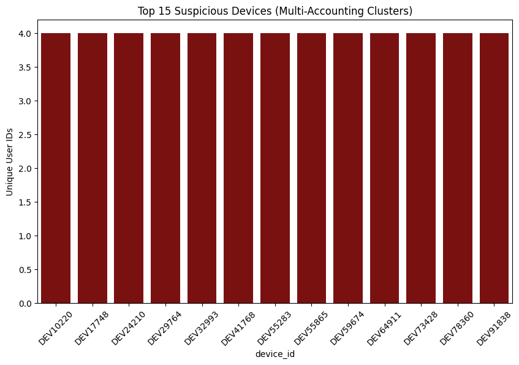
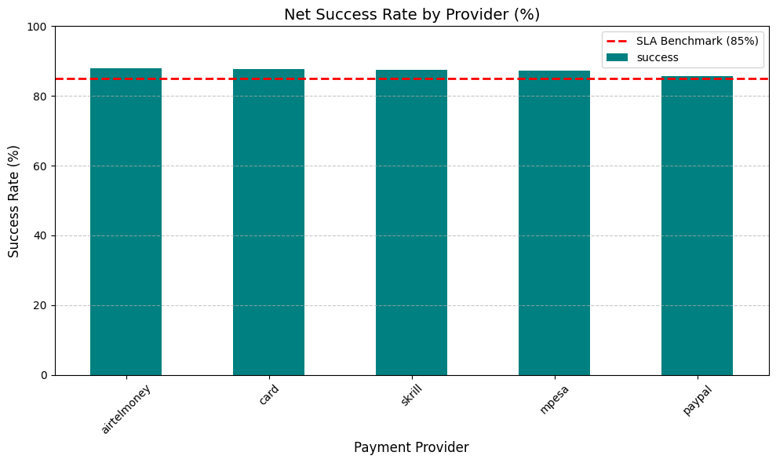

# 🛡️ Project Shield & Scale
## iGaming Fraud Intelligence & Payments Operations Analytics

<div align="center">


**Payments operations and risk analysis on 20,000 simulated iGaming transaction attempts**  
*Fraud risk screening · Entity analysis · Operational performance · Provider benchmarking*

[📓 Open Notebook](./Fraud_and_Monitoring%28Project_Shield_and_Scale%29.ipynb) · [📊 View Dataset](./igaming_payments_20k.csv)

</div>

---

## 📌 What This Project Does

I developed Project Shield & Scale to explore the types of problems I encounter in payments operations. I used **simulated payments data** to investigate three questions:

> *"Which providers show elevated fraud-suspected rates? Which device-linked patterns warrant review? Where are technical failures concentrated?"*

I organised the analysis into **four workstreams**, covering fraud risk, shared devices, payment performance and recommendations.

---

## 🎯 Key Results

| Finding | Value |
|---------|-------|
| Transactions analysed | **20,000** |
| Successful attempts | **17,477 (87.39%)** |
| Fraud-suspected attempts | **653** |
| Provider errors | **637** |
| Timeouts | **637** |
| Insufficient funds | **596** |
| Devices linked to more than three users | **13** |
| Users exceeding five attempts in a rolling hour | **0** |

> Figures are based on saved notebook outputs, not a new execution. These are simulated results, not actual provider performance or confirmed fraud.

---

##  Architecture

```
igaming_payments_20k.csv  (20,000 transactions)
        │
        ▼
┌─────────────────────────────────────────────┐
│           ETL & Data Quality Layer           │
│  Google Sheets → SQLite (automated)          │
│  Data assertions · Schema validation         │
└──────────────────┬──────────────────────────┘
                   │
        ┌──────────┴──────────┐
        ▼                     ▼
┌───────────────┐    ┌─────────────────────┐
│  SQL Engine   │    │   Python Analytics  │
│  (SQLite)     │    │   (Pandas / Seaborn)│
│               │    │                     │
│ Aggregations  │    │ Entity linking      │
│ KPI queries   │    │ Velocity analysis   │
│ Market totals │    │ Failure analysis    │
└───────┬───────┘    └──────────┬──────────┘
        └──────────┬────────────┘
                   ▼
        ┌──────────────────────┐
        │   4 Analytical       │
        │   Workstreams        │
        │                      │
        │  WS1: Fraud Risk     │
        │  WS2: Entity Intel   │
        │  WS3: Ops Health     │
        │  WS4: Decision Supp. │
        └──────────┬───────────┘
                   ▼
        Executive-ready charts + findings
```

---

## 📊 Dashboard Preview

### Fraud-suspected flags by channel


### Entity Intelligence: Multi-Accounting Detection


### Provider Performance Benchmarking



> *I created these visualisations in the notebook to make the findings easier to understand.*

---

## 🔬 Analytical Workstreams

### Workstream 1: Fraud Risk Deep Dive 🚨

**Question:** Which providers, countries, and channels pose the highest fraud risk?

**My approach:**
- Compared suspected fraud rates by provider and channel.
- Examined the distribution of transaction values.
- Compared the concentration of fraud flags against transaction volumes.

**Outputs:**
- Ranked provider fraud risk table
- Fraud rate benchmarks per channel

---

### Workstream 2: Entity Intelligence & Multi-Accounting 🔗

**Question:** Which shared-device patterns warrant further investigation?

**My approach:**
- Device ID → User ID mapping (many-to-many relationship analysis)
- Shared-device grouping across user accounts
- Overlap between devices with successful and fraud-suspected attempts (not a chronological test)
- Velocity burst detection: abnormal transaction frequency clustering

**Outputs:**
- Multi-accounting cluster map
- Device overlap for further manual review
- Velocity anomaly flags per user/device group

---

### Workstream 3: Operational Health & Payment Failures 💰

**Question:** Which failure categories contribute most to payment friction?

**My approach:**
- Failure reason breakdown (timeout vs provider error vs user error)
- Technical failure counts by provider and hour
- Currency success rate comparison across corridors

**Outputs:**
- Failure counts by category
- Payment conversion funnel
- Currency corridor performance ranking

---

### Workstream 4: Decision Support Intelligence 🎯

**Question:** Which operational and risk issues should be investigated first?

**My approach:**
- Comparative impact analysis across providers, channels, and corridors
- Interpretation of provider and currency performance
- Prioritisation of technical failure investigations and device reviews

**Outputs:**
- Suggested operational and risk actions
- Limitations and follow-up investigation priorities
- Executive decision brief

---

##  Repository Structure

```
payments-intelligence/
├── Fraud_and_Monitoring(Project_Shield_and_Scale).ipynb
├── igaming_payments_20k.csv
├── README.md
├── requirements.txt
├── Fraud detection in iGaming analytics_background.png
└── shiled_and_scale_images/
    ├── FraudRate_distribution.png
    ├── Fraudrate_by_channel.png
    ├── failures_by_hour.png
    ├── multi_accounting_clusters.png
    ├── suucess_by_provider.png
    └── title.jpg
```

---

##  Tech Stack

| Tool | Purpose |
|------|---------|
| **Python 3.10+** | Core analytics language |
| **Pandas** | Data manipulation, aggregation, KPI calculation |
| **SQLite + SQL** | ETL pipeline, structured queries, KPI extraction |
| **Matplotlib / Seaborn** | Executive-ready visualisations |
| **Jupyter Notebook** | Analysis environment and storytelling |
| **Google Sheets** | Initial data inspection and ETL source |

---

## 🚀 How to Run

### Option A: Google Colab

1. Open the [notebook on GitHub](./Fraud_and_Monitoring%28Project_Shield_and_Scale%29.ipynb) and download it.
2. Upload it to Google Colab.
3. Adjust the Google Drive database path and Google Sheets authentication/access in the setup cells before running. The included CSV can be used to adapt ingestion.

The saved notebook outputs can be reviewed on GitHub without running the code.

### Option B: Local (requires ingestion changes)

Adapt the Colab-specific Drive and Sheets setup to load the included CSV into SQLite before running locally.

```bash
# Clone the repository
git clone https://github.com/mutumaian29/payments-intelligence.git
cd payments-intelligence

# Install dependencies
pip install -r requirements.txt

# Launch notebook
jupyter notebook "Fraud_and_Monitoring(Project_Shield_and_Scale).ipynb"
```

---

## 📦 Dataset

| Field | Detail |
|-------|--------|
| **File** | `igaming_payments_20k.csv` |
| **Rows** | 20,000 transaction attempts |
| **Domain** | iGaming payments |
| **Granularity** | Transaction-level |
| **Data source** | Synthetic data for portfolio analysis |

**Key columns:**

| Column | Description |
|--------|-------------|
| `transaction_id` | Unique transaction reference |
| `user_id` | Simulated user identifier |
| `device_id` | Device fingerprint (for entity linking) |
| `ip_address` | IP address (for entity linking) |
| `provider` | Payment provider name |
| `currency` | Transaction currency |
| `country` | Transaction origin country |
| `transaction_type` | Deposit or withdrawal |
| `status` | `success` / `failed` (fraud_suspected is a failure reason) |
| `failure_reason` | Root cause of failure (timeouts, errors, etc.) |
| `amount` | Transaction value |
| `created_at` | Transaction datetime |

---

## 💡 Why This Project Exists

I wanted to apply my experience in payments operations to a practical analytics project. Rather than simply counting failed transactions or suspicious activity, I wanted to understand what the results could mean for an operations team.

My focus was on identifying issues worth investigating, comparing payment performance and communicating findings clearly. I also wanted to distinguish potential risk indicators from confirmed fraud.

---

## Analytical limitations

Shared devices and suspected fraud labels are indicators for review, not proof of fraud. I would compare hourly failure rates against total attempts before drawing conclusions about provider reliability. Failed transaction values do not represent guaranteed revenue recovery.

One area I still need to correct is the initial cash flow query. It should include only successful transactions and subtract withdrawals from deposits. The existing cash flow figures should not be used until that calculation is corrected.

---

## 🗺️ Roadmap

- [x] Phase 1: ETL pipeline + data quality
- [x] Phase 2: Fraud risk workstream
- [x] Phase 3: Entity intelligence workstream
- [x] Phase 4: Operational health workstream
- [x] Phase 5: Decision support workstream
- [ ] Phase 6: Chargeback and dispute integration
- [ ] Phase 7: Real-time alerting logic
- [ ] Phase 8: ML fraud scoring (Isolation Forest)
- [ ] Phase 9: Reconciliation and settlement workstream

---

## 👤 Author

**Ian Mutuma**: Payments Operations Specialist | iGaming & Fintech

- 📧 mutumaian29@gmail.com
- 🐙 [GitHub](https://github.com/mutumaian29)

*Focus areas: Payments analytics · Fraud monitoring · Reconciliation · AML · Risk intelligence*

---

<div align="center">

*If this project was useful, a ⭐ is appreciated.*


</div>
