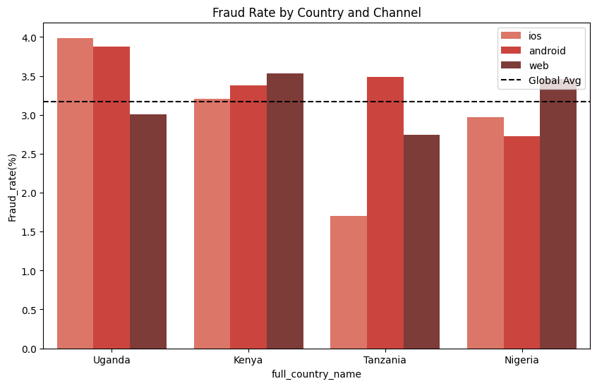

# Project Shield & Scale

## Payments operations and fraud analytics

A portfolio project exploring 20,000 simulated iGaming payment attempts using SQL and Python. It demonstrates data validation, operational KPI analysis, provider benchmarking and risk screening.

[Analysis notebook](./Fraud_and_Monitoring%28Project_Shield_and_Scale%29.ipynb) · [Dataset](./igaming_payments_20k.csv)

## Business questions

- Which payment channels and markets warrant further performance investigation?
- What types of failures contribute to payment friction?
- Which device-linked patterns warrant manual risk review?

## Selected findings

The following figures come from saved notebook outputs; they have not been independently rerun.

| Metric | Result |
|---|---:|
| Payment attempts | 20,000 |
| Successful attempts | 17,477 (87.39%) |
| Provider errors | 637 |
| Timeouts | 637 |
| Insufficient funds | 596 |
| Fraud-suspected attempts | 653 |
| Devices linked to more than three users | 13 |
| Users exceeding five attempts in a rolling hour | 0 |

Currency-level success rates ranged from 87.03% (KES) to 87.88% (UGX).

## Visual examples

### Fraud flags by channel

### Device clusters

### Provider performance

## Methodology

1. Import data from Google Sheets into SQLite and apply data-quality checks.
2. Create a standardised SQL view and load it into Pandas.
3. Compare fraud-suspected flags by provider and channel.
4. Explore device sharing and rolling transaction frequency.
5. Analyse failure categories, hourly failure counts and success rates.

## Recommendations and limitations

- Investigate provider errors and timeouts first: together they account for 1,274 attempts. Compare rates as well as counts before prioritising providers.
- Review shared-device clusters manually; shared devices are risk indicators, not proof of fraud.
- Validate transaction chronology before interpreting overlapping successful and flagged device activity as control bypass.
- Failed payment amounts are not equivalent to lost revenue or guaranteed recoveries. Deposits and withdrawals must be distinguished.
- The notebook's initial cash-flow query needs correction: it does not filter successful transactions and subtracts withdrawals from total volume rather than from deposits. Its reported net cash-flow figures should not be relied on until corrected.

This is simulated data, not evidence of actual provider performance or customer fraud. Machine-learning scoring and real-time alerts are future extensions, not implemented capabilities.

## Reproducing the analysis

The original notebook uses Google Colab, Google Drive, Google Sheets authentication and SQLite. Review its setup cells and adjust the spreadsheet access and database path for your environment. A CSV is included for adapting the ingestion step to local execution.

Python dependencies are listed in [requirements.txt](requirements.txt).

**Tools:** Python, Pandas, SQLite, SQL, Matplotlib, Seaborn, Plotly, Jupyter.

**Author:** Ian Mutuma · [LinkedIn](https://linkedin.com/in/ian-mutuma-3639bb280)
